# 智能记忆助手 App -- 项目完整技术规划

---

## 一、整体架构（纯本地，无后端）

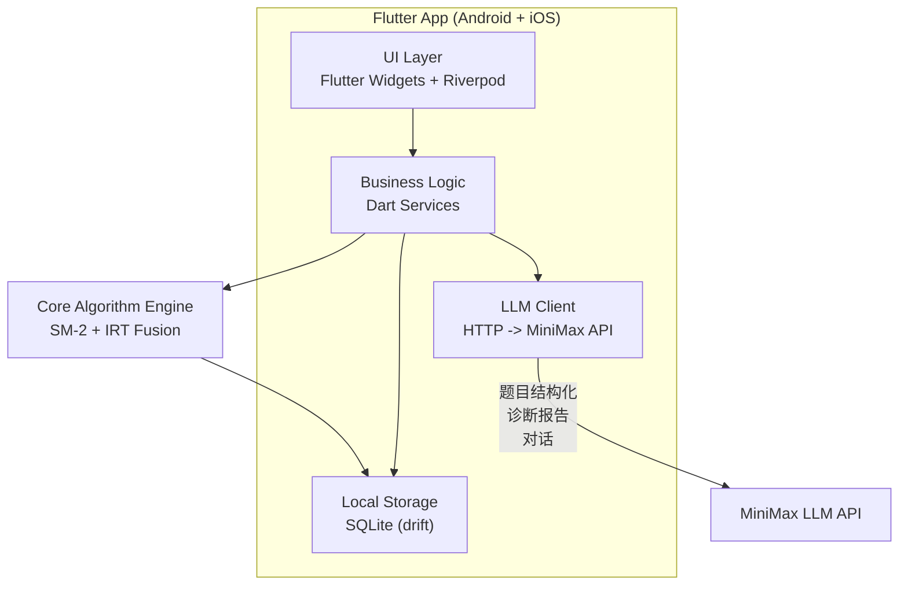


**技术栈：**

- **框架**: Flutter (Dart), 目标 Android + iOS
- **本地数据库**: SQLite, 通过 `drift` (原 moor) 包操作（类型安全 ORM）
- **知识图谱**: SQLite 邻接表 + 内存缓存
- **LLM**: MiniMax API，`dio` 包 HTTP 直连
- **状态管理**: `Riverpod`
- **图表**: `fl_chart`
- **导入/导出**: JSON 序列化（`json_serializable`）

---

## 二、核心算法设计：SM-2 + IRT(1PL) 融合

### 2.1 数据采集参数（每次答题事件）


| 参数                      | 类型        | 用途             | 说明                    |
| ----------------------- | --------- | -------------- | --------------------- |
| `is_correct`            | bool      | IRT能力估计 + SM-2 | 最基础的指标                |
| `selected_option_index` | int       | 干扰项分析          | 选了哪个选项（正确/错误都记录）      |
| `response_time_ms`      | int       | QS计算           | 从题目展示到提交答案的毫秒数        |
| `confidence_rating`     | int (1-5) | QS计算           | 答后自评信心度（替代SM-2的0-5评分） |
| `hesitation_count`      | int       | 行为特征           | 切换选项的次数（犹豫度）          |
| `timestamp`             | DateTime  | 时序分析           | 答题时间点                 |
| `review_number`         | int       | SM-2间隔计算       | 该知识点第几次复习             |


**设计理由**：

- `is_correct` + `response_time_ms` 是 IRT 和 QS 的基础
- `selected_option_index` 让 LLM 能分析"为什么选错"（干扰项诊断）
- `confidence_rating` 比传统 SM-2 的"熟悉度"更自然
- `hesitation_count` 是低成本高信息量的行为指标
- 没有加入"暂停时长"——手机场景下暂停可能是被打断而非思考，噪声太大

### 2.2 记忆质量评分 QS（替代 SM-2 原始评分）

```
QS = w1 * confidence_normalized + w2 * time_score + w3 * correctness_bonus + w4 * hesitation_penalty
```

- `confidence_normalized` = confidence_rating / 5.0
- `time_score` = sigmoid衰减函数，响应越快分越高
- `correctness_bonus` = 答对 +0.2, 答错 -0.3（不对称惩罚）
- `hesitation_penalty` = -0.05 * hesitation_count
- 权重初始值: w1=0.35, w2=0.25, w3=0.30, w4=0.10
- **QS 范围映射到 [0, 5]**，直接替代 SM-2 的 q 值

### 2.3 IRT(1PL/Rasch) 能力估计

- **题目难度 b**：初始值由 LLM 评估（1-5映射到 [-2, 2]），后续在线微调
- **用户能力 theta**：MLE，Newton-Raphson 迭代求解

```
theta_MLE = argmax SUM[ x_i * ln(P_i) + (1-x_i) * ln(1-P_i) ]
P_i = 1 / (1 + exp(-(theta - b_i)))
```

### 2.4 SM-2 + IRT 融合逻辑

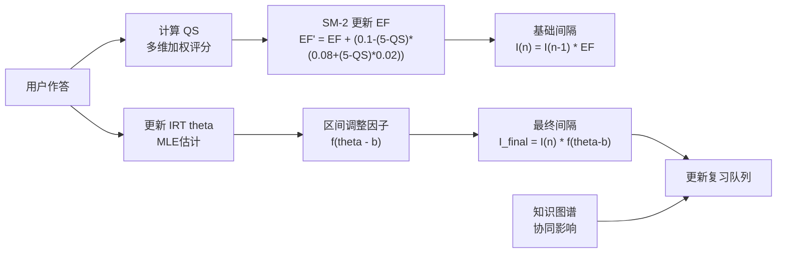


**区间调整因子 f(theta - b)**：

- `f(d) = 1 + 0.3 * tanh(d)`，d = theta - b，输出范围约 [0.7, 1.3]
- theta >> b：f > 1，拉长间隔（太简单）
- theta ≈ b：f = 1，标准间隔
- theta << b：f < 1，缩短间隔（需多练）

### 2.5 知识图谱协同复习

**协同优先级公式**：

```
PS(i) = base_urgency(i) + alpha * SUM(forgetting(j) * weight(i,j))
```

- BFS 深度限制为2层，避免过度传播

---

## 三、完整类结构设计

### 3.1 数据模型层（Models）

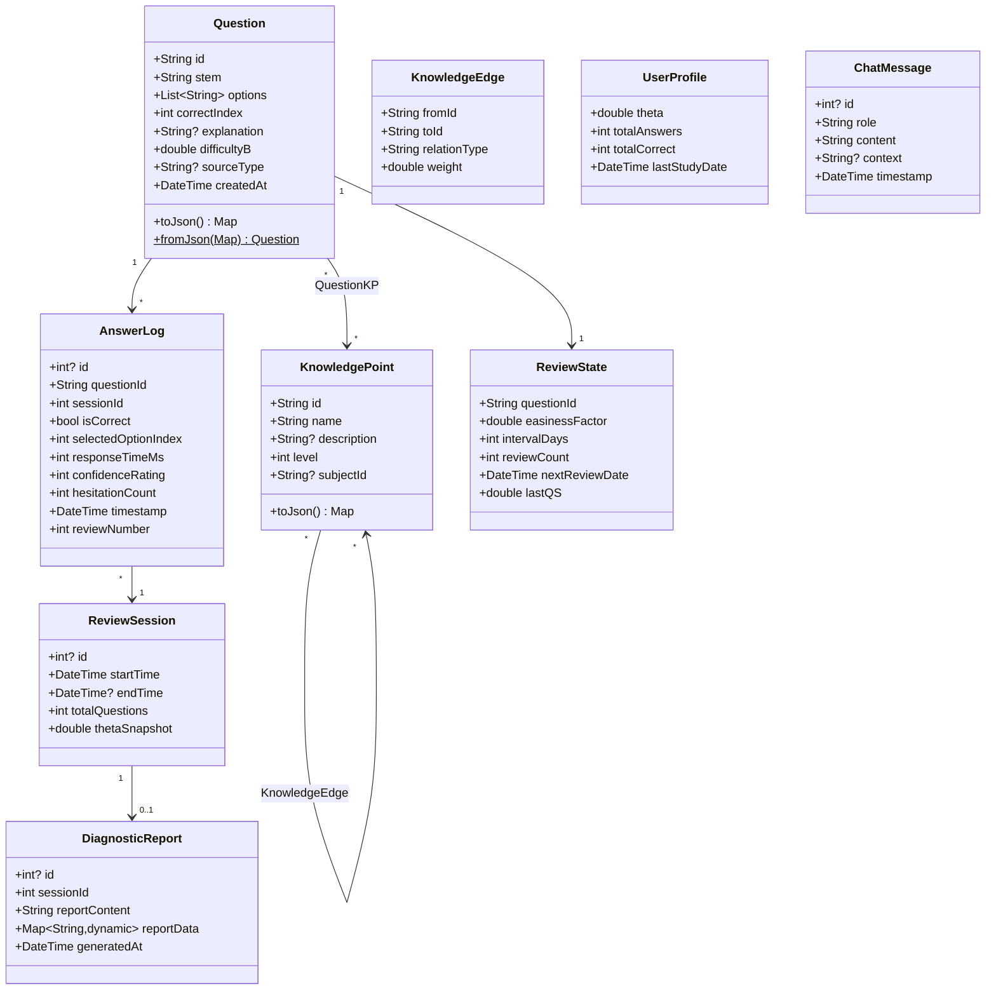


### 3.2 核心算法层（Core Engine）

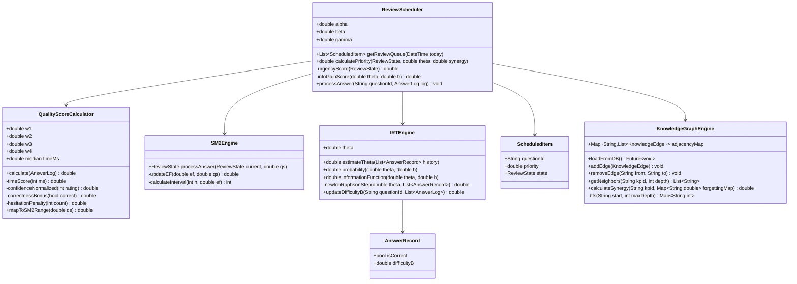


### 3.3 LLM 服务层

```mermaid
classDiagram
    class MiniMaxClient {
        +String apiKey
        +String baseUrl
        +Dio dio
        +Future~String~ chat(List~ChatMsg~ messages, String? systemPrompt)
        +Future~String~ chatStream(List~ChatMsg~ messages, Stream~String~ callback)
        -handleError(DioException) void
        -buildHeaders() Map
    }

    class QuestionStructureService {
        +MiniMaxClient client
        +Future~List~Question~~ structurizeText(String rawText)
        +Future~List~String~~ generateDistractors(String stem, String answer, String kpContext)
        +Future~Question~ enrichQuestion(Question partial)
        -buildStructurePrompt(String text) String
        -parseQuestionJson(String json) List~Question~
    }

    class DiagnosisService {
        +MiniMaxClient client
        +Future~DiagnosticReport~ generateReport(ReviewSession session, List~AnswerLog~ logs, double theta, List~KnowledgePoint~ weakPoints)
        -buildDiagnosisPrompt(Map context) String
        -parseReportJson(String json) DiagnosticReport
    }

    class ChatService {
        +MiniMaxClient client
        +List~ChatMessage~ history
        +Future~String~ sendMessage(String message, String? questionContext)
        +Stream~String~ sendMessageStream(String message, String? questionContext)
        +String buildInstantGuidancePrompt(Question q, AnswerLog log)
        +clearHistory() void
    }

    class KnowledgeGraphService {
        +MiniMaxClient client
        +Future~List~KnowledgePoint~~ extractKnowledgePoints(List~Question~ questions)
        +Future~List~KnowledgeEdge~~ inferRelations(List~KnowledgePoint~ points)
        -buildKPExtractionPrompt(List~Question~) String
    }

    QuestionStructureService --> MiniMaxClient
    DiagnosisService --> MiniMaxClient
    ChatService --> MiniMaxClient
    KnowledgeGraphService --> MiniMaxClient
```


### 3.4 数据访问层（Repository + DAO）

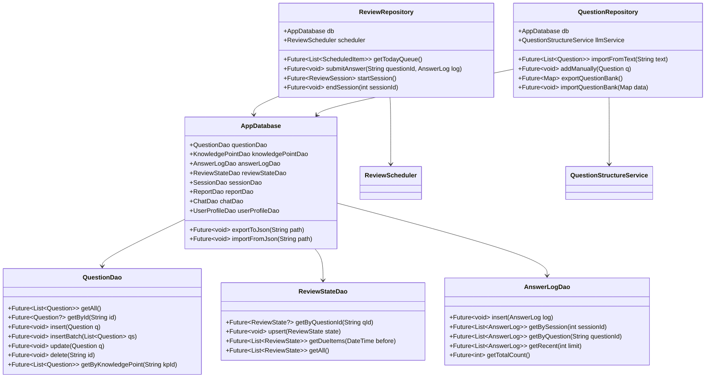


### 3.5 UI 状态管理层（Riverpod Providers）

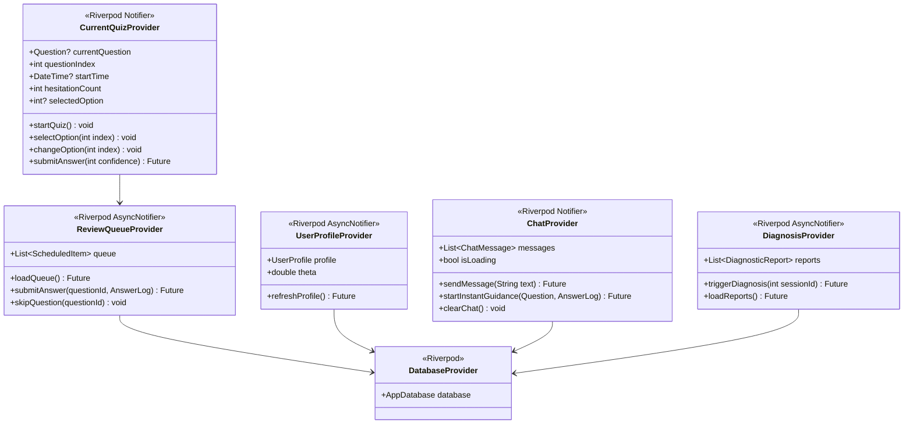


---

## 四、数据库 Schema 设计（drift ORM）

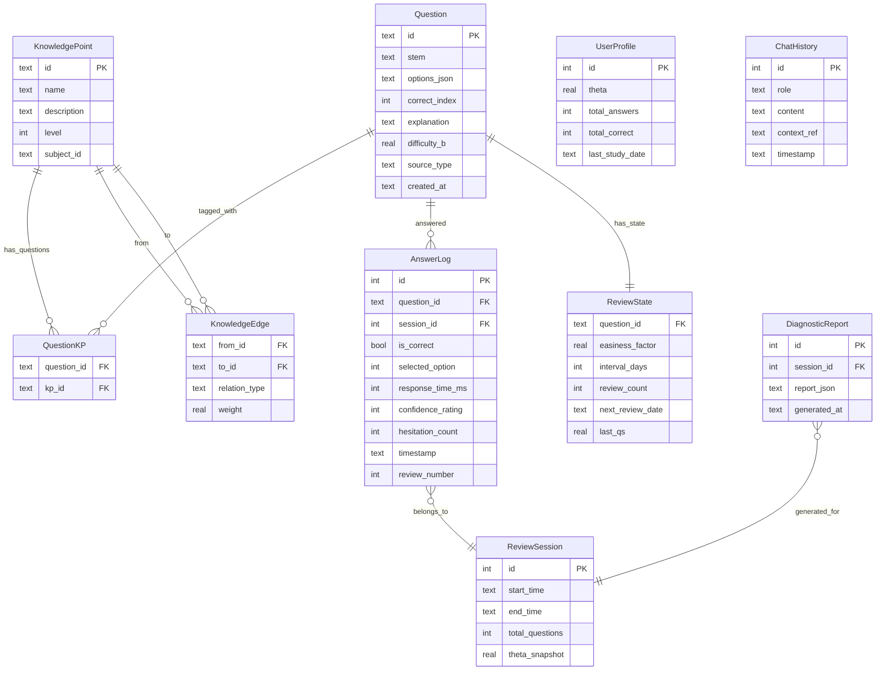


---

## 五、LLM (MiniMax) 集成设计

### 5.1 三大调用场景

**场景A：题目结构化处理**（用户导入内容时触发）

- 输入：用户录入的原始文本/知识点
- Prompt 策略：Few-shot + 明确 JSON schema 约束
- 输出：结构化 JSON（题干、选项、答案、解析、知识点标签、难度评估 b）
- 同时输出知识点之间的关联关系，用于构建图谱

**场景B：周期性诊断报告**（每10题或用户主动触发）

- 输入：该周期内所有 AnswerLog + 当前 theta 值 + 薄弱知识点列表
- 输出：阶段能力评估、薄弱点分析、个性化学习建议
- Prompt 中注入 theta 值和统计数据

**场景C：即时对话引导**（答完题查看解析时触发）

- 输入：题目内容 + 用户选择 + 正确答案 + 是否犹豫
- 输出：启发式对话
- 流式输出（streaming），提升交互体验

### 5.2 API 调用架构

通过 `dio` 包直接 HTTP 调用 MiniMax API：

- 请求限流（避免触发 API 限额）
- 错误重试机制（指数退避）
- 本地缓存相似请求的结果（节省 token 消耗）

---

## 六、完整数据流转图

### 6.1 核心复习流程数据流

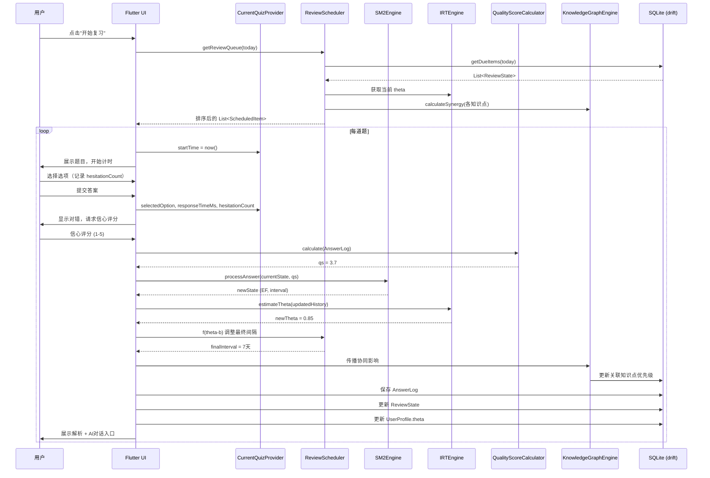


### 6.2 题目导入数据流

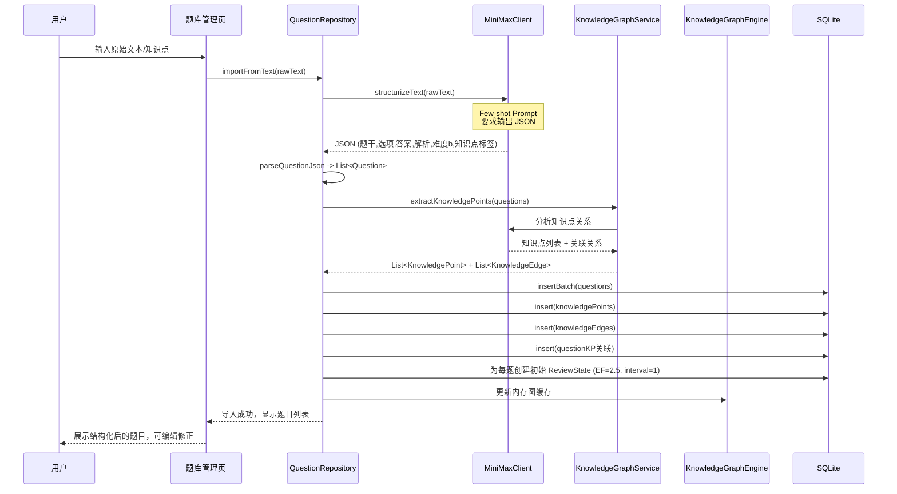


### 6.3 诊断报告生成数据流

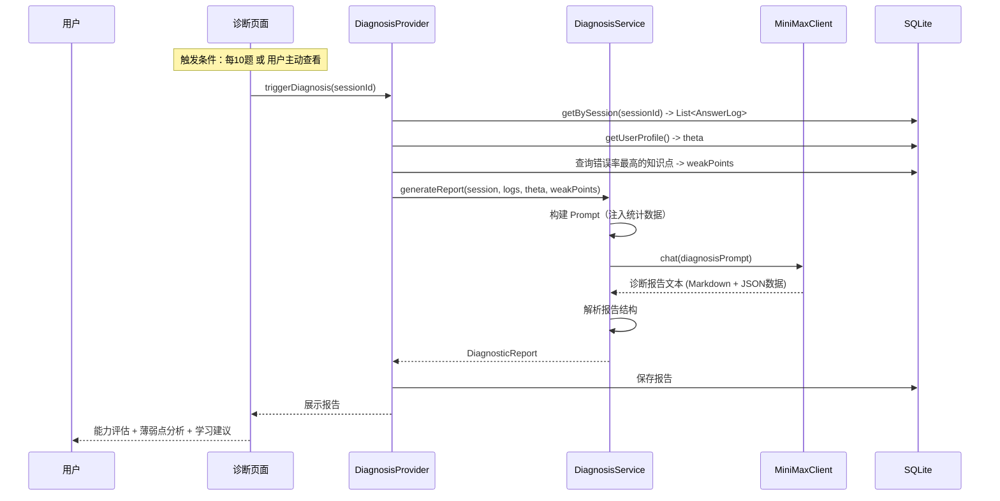


---

## 七、App 页面结构与交互流程

### 7.1 页面导航结构

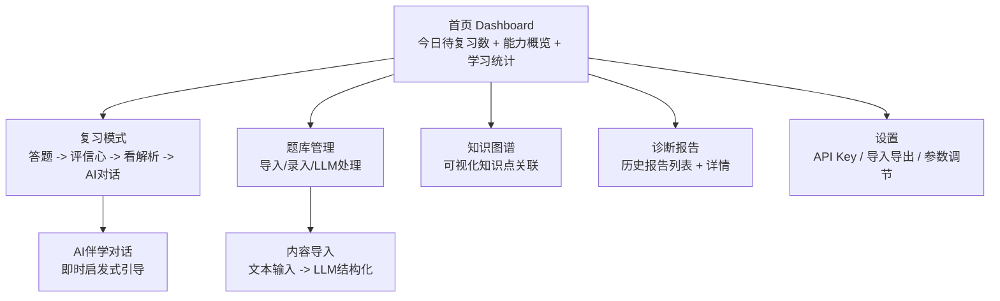


### 7.2 核心页面交互线框描述

**页面1：首页 Dashboard**

```
┌──────────────────────────────────┐
│  智能记忆助手            [设置⚙️]  │
├──────────────────────────────────┤
│  ┌────────────┐ ┌────────────┐  │
│  │ 今日待复习   │ │ 能力值 θ    │  │
│  │    12 题    │ │   0.85     │  │
│  │ [开始复习]  │ │  ↑ 0.12    │  │
│  └────────────┘ └────────────┘  │
│                                  │
│  能力趋势图 (fl_chart 折线图)      │
│  ┌──────────────────────────┐   │
│  │  θ                        │   │
│  │  ╱‾‾╲    ╱‾              │   │
│  │ ╱    ╲╱╱                  │   │
│  │ ────────────── 日期        │   │
│  └──────────────────────────┘   │
│                                  │
│  本周统计                         │
│  答题 45 | 正确率 78% | 连续 3天   │
│                                  │
│  薄弱知识点 TOP3                   │
│  1. 概率论-条件概率  正确率 40%     │
│  2. 线代-特征值     正确率 55%     │
│  3. 高数-级数收敛   正确率 60%     │
├──────────────────────────────────┤
│  [首页]  [题库]  [图谱]  [报告]   │
└──────────────────────────────────┘
```

**页面2：复习答题页**

```
┌──────────────────────────────────┐
│  ← 复习模式        3/12    ⏱ 23s │
├──────────────────────────────────┤
│                                  │
│  以下哪个是贝叶斯公式的正确形式？  │
│                                  │
│  ┌──────────────────────────┐   │
│  │ A. P(A|B) = P(B|A)P(A)  │   │  ← 未选中
│  │            / P(B)        │   │
│  └──────────────────────────┘   │
│  ┌──────────────────────────┐   │
│  │ B. P(A|B) = P(A)P(B)    │   │  ← 选中高亮
│  └──────────────────────────┘   │
│  ┌──────────────────────────┐   │
│  │ C. P(A|B) = P(B) / P(A) │   │
│  └──────────────────────────┘   │
│  ┌──────────────────────────┐   │
│  │ D. P(A|B) = P(A∩B)      │   │
│  └──────────────────────────┘   │
│                                  │
│         [ 确认提交 ]              │
└──────────────────────────────────┘

提交后 → 结果页：
┌──────────────────────────────────┐
│  ← 答题结果                       │
├──────────────────────────────────┤
│       ❌ 回答错误                  │
│  你选了 B，正确答案是 A            │
│  用时: 23秒 | 犹豫次数: 2          │
│                                  │
│  你对这道题有多确信？              │
│  [1😰] [2😕] [3😐] [4🙂] [5😎]  │
│                                  │
│  ─── 解析 ───                    │
│  贝叶斯公式的标准形式为...         │
│  P(A|B) = P(B|A) * P(A) / P(B)  │
│                                  │
│  ┌──────────────────────────┐   │
│  │ 🤖 AI伴学想和你聊聊这道题  │   │
│  │    [开始对话 →]           │   │
│  └──────────────────────────┘   │
│                                  │
│         [ 下一题 → ]             │
└──────────────────────────────────┘
```

**页面3：AI 对话页**

```
┌──────────────────────────────────┐
│  ← AI 伴学对话                    │
├──────────────────────────────────┤
│                                  │
│  ┌─────────────────────────┐    │
│  │🤖 我注意到你选了B选项，    │    │
│  │ 也就是 P(A|B)=P(A)P(B)。│    │
│  │ 这其实是A和B独立时的公式。│    │
│  │ 你是不是把"独立"和"条件"  │    │
│  │ 搞混了？                 │    │
│  └─────────────────────────┘    │
│                                  │
│  ┌─────────────────────────┐    │
│  │ 好像是的，独立和条件概率   │👤  │
│  │ 有什么本质区别？          │    │
│  └─────────────────────────┘    │
│                                  │
│  ┌─────────────────────────┐    │
│  │🤖 好问题！关键区别在于... │    │
│  │ （流式输出中...）         │    │
│  └─────────────────────────┘    │
│                                  │
│  ┌──────────────────────┐ [发送] │
│  │ 输入你的问题...        │       │
│  └──────────────────────┘       │
└──────────────────────────────────┘
```

**页面4：题库管理页**

```
┌──────────────────────────────────┐
│  题库管理              [+ 导入]   │
├──────────────────────────────────┤
│  搜索题目...              🔍     │
│                                  │
│  ┌ 概率论 (23题) ──────────────┐ │
│  │  条件概率 (8题)              │ │
│  │  贝叶斯定理 (6题)            │ │
│  │  随机变量 (9题)              │ │
│  └──────────────────────────────┘ │
│  ┌ 线性代数 (15题) ────────────┐ │
│  │  矩阵运算 (7题)              │ │
│  │  特征值 (8题)                │ │
│  └──────────────────────────────┘ │
│                                  │
│  [+ 手动录入]  [📄 文本导入]     │
│                                  │
├──────────────────────────────────┤
│  [首页]  [题库]  [图谱]  [报告]   │
└──────────────────────────────────┘

文本导入流程：
┌──────────────────────────────────┐
│  ← 文本导入                       │
├──────────────────────────────────┤
│  请输入题目文本或知识点：          │
│  ┌──────────────────────────┐   │
│  │ 贝叶斯公式是概率论中的     │   │
│  │ 重要公式，用于计算后验     │   │
│  │ 概率。P(A|B) = P(B|A) *  │   │
│  │ P(A) / P(B)...           │   │
│  │                          │   │
│  └──────────────────────────┘   │
│                                  │
│  [🤖 AI 结构化处理]              │
│                                  │
│  处理结果预览：                    │
│  ✅ 生成 3 道选择题               │
│  ✅ 识别 2 个知识点               │
│  ✅ 建立 1 条知识关联             │
│                                  │
│  [编辑修正]    [确认导入]         │
└──────────────────────────────────┘
```

**页面5：诊断报告页**

```
┌──────────────────────────────────┐
│  ← 诊断报告 #5                   │
├──────────────────────────────────┤
│  2026-03-29 学习会话              │
│  答题 10 道 | 正确 7 道 | θ=0.85  │
│                                  │
│  能力雷达图 (fl_chart)            │
│       概率论                      │
│        ╱╲                        │
│  线代 ╱  ╲ 高数                   │
│       ╲╱                         │
│                                  │
│  ─── AI 诊断分析 ───             │
│  你在条件概率相关题目上表现较弱，  │
│  建议重点复习贝叶斯定理与全概率    │
│  公式的区别...                    │
│                                  │
│  薄弱知识点：                     │
│  🔴 条件概率 (正确率 40%)         │
│  🟡 特征值计算 (正确率 55%)       │
│  🟢 矩阵乘法 (正确率 90%)        │
│                                  │
│  个性化建议：                     │
│  1. 先巩固条件概率基础概念         │
│  2. 对比练习独立事件与条件事件     │
│  3. ...                          │
└──────────────────────────────────┘
```

### 7.3 复习模式完整交互流程

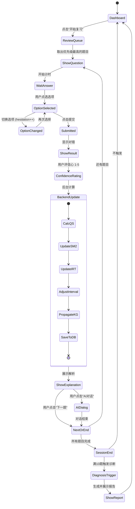


---

## 八、与毕设论文结构的对应关系

下表展示了项目各模块与毕设论文典型章节的对应关系，帮助你在开发的同时积累论文素材：


| 论文章节                | 对应项目模块                                                                    | 需要准备的素材                                                                                      |
| ------------------- | ------------------------------------------------------------------------- | -------------------------------------------------------------------------------------------- |
| **第1章 绪论**          | 整体项目                                                                      | 研究背景（间隔重复现状）、研究意义、国内外研究综述（SM-2、IRT、LLM辅助教育）                                                  |
| **第2章 相关技术与理论基础**   | 算法设计文档                                                                    | SM-2算法原理、IRT(1PL)模型数学推导、LLM技术概述、Flutter技术选型理由                                                |
| **第3章 系统需求分析与总体设计** | 架构图 + 数据流图                                                                | 功能需求列表、非功能需求、系统架构图（本文档第一节）、数据流图（第六节）                                                         |
| **第4章 核心算法设计与实现**   | SM2Engine + IRTEngine + QualityScoreCalculator + ReviewScheduler          | QS公式推导与参数选择理由、IRT theta估计的MLE推导、融合公式 f(theta-b) 的设计动机、知识图谱协同算法、**算法流程图**（本文档2.4节）、**关键代码片段** |
| **第5章 LLM集成与智能诊断**  | MiniMaxClient + DiagnosisService + ChatService + QuestionStructureService | Prompt设计策略、Few-shot示例、结构化输出JSON Schema、诊断报告生成流程、对话系统设计                                       |
| **第6章 系统详细设计与实现**   | 数据库Schema + 类结构 + UI页面                                                    | ER图（第四节）、类图（第三节）、关键页面截图、交互流程图（第七节）                                                           |
| **第7章 系统测试与分析**     | 测试用例 + 实验数据                                                               | 算法正确性测试（SM-2间隔是否合理、IRT theta收敛性）、LLM输出质量评估、用户体验测试、**对比实验**（纯SM-2 vs SM-2+IRT融合的复习效率对比）       |
| **第8章 总结与展望**       | 整体项目                                                                      | 工作总结、创新点归纳（双层解耦调度、QS多维评分、LLM认知诊断）、不足与未来工作                                                    |


**论文核心创新点提炼**（答辩时重点强调）：

1. **双层解耦调度模型**：SM-2负责"是否该复习"（时间维度），IRT负责"先复习谁"（能力维度），通过 f(theta-b) 区间调整因子实现深度融合
2. **多维记忆质量评分 QS**：融合主观信心、客观正误、响应时间、犹豫行为四个维度，替代传统SM-2的单一主观评分
3. **LLM驱动的认知诊断闭环**：从题目结构化 → 知识图谱构建 → 行为数据采集 → 智能诊断报告 → 启发式对话，形成完整的"数据采集—智能诊断—自适应干预"链路

---

## 九、开发排期（8周）

- **第1-2周 -- 基础骨架**：Flutter项目搭建、drift数据库建表、基础UI框架（导航+页面骨架）、数据模型定义
- **第3-4周 -- 核心算法**：SM-2引擎、IRT(1PL) theta估计、QS计算、融合逻辑与复习队列调度、知识图谱BFS协同
- **第5-6周 -- LLM集成**：MiniMax API封装、题目结构化Prompt、诊断报告生成、即时对话系统（含流式输出）
- **第7周 -- 功能闭环**：题库导入流程、JSON导入导出、知识图谱可视化、统计仪表盘
- **第8周 -- 打磨收尾**：UI美化、Bug修复、性能优化、毕设文档素材准备

---

## 十、关键技术依赖（Flutter 包）

- `drift` + `sqlite3_flutter_libs`：类型安全的 SQLite ORM
- `flutter_riverpod` + `riverpod_annotation`：状态管理
- `dio`：HTTP 请求
- `fl_chart`：图表
- `json_annotation` + `json_serializable`：JSON 序列化
- `file_picker` + `share_plus`：文件导入导出
- `flutter_markdown`：Markdown 渲染
- `uuid`：唯一标识生成
- `path_provider`：本地文件路径

---

## 十一、项目目录结构

```
lib/
  main.dart
  app.dart
  core/
    algorithms/
      sm2_engine.dart
      irt_engine.dart
      scheduler.dart
      quality_score.dart
    knowledge_graph/
      graph_engine.dart
      synergy_calculator.dart
  data/
    database/
      app_database.dart         # drift 数据库定义
      app_database.g.dart       # 自动生成
      tables/                   # 表定义
    models/                     # 数据模型
    repositories/               # Repository 层
  features/
    home/
      home_page.dart
      widgets/
    study/
      quiz_page.dart
      result_page.dart
      widgets/
    question_bank/
      question_bank_page.dart
      import_page.dart
      widgets/
    diagnosis/
      report_list_page.dart
      report_detail_page.dart
      widgets/
    chat/
      chat_page.dart
      widgets/
    settings/
      settings_page.dart
      widgets/
  llm/
    minimax_client.dart
    services/
      question_structure_service.dart
      diagnosis_service.dart
      chat_service.dart
      knowledge_graph_service.dart
    prompts/
      question_structure_prompt.dart
      diagnosis_prompt.dart
      chat_prompt.dart
    parsers/
      question_parser.dart
      report_parser.dart
  providers/
    database_provider.dart
    review_queue_provider.dart
    current_quiz_provider.dart
    user_profile_provider.dart
    chat_provider.dart
    diagnosis_provider.dart
  shared/
    widgets/
      option_card.dart
      confidence_slider.dart
      stat_card.dart
    theme/
      app_theme.dart
      colors.dart
    utils/
      date_utils.dart
      math_utils.dart
    constants.dart
```

---

## 十二、关键风险与应对

- **IRT冷启动**：新用户/新题目数据不足 → 依赖LLM初始化难度b值，theta初始为0，前20题快速收敛
- **MiniMax API延迟**：网络不佳时 → 对话和报告异步生成，复习核心流程完全离线可用
- **2个月周期紧张**：优先保证核心算法+基础复习流程，AI对话和知识图谱可视化可适当简化
- **LLM输出不稳定**：JSON解析失败 → 设计容错机制，提供手动编辑入口

